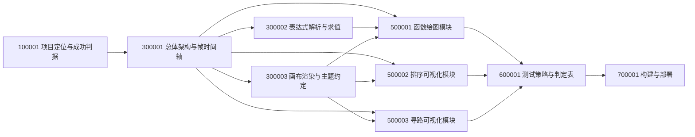

# 全库总索引

- [概述](#概述)
- [子文档索引](#子文档索引)
- [依赖关系](#依赖关系)
- [入口与路径](#入口与路径)
- [数据概览](#数据概览)
- [实现状态](#实现状态)
- [涉及文件](#涉及文件)
- [相关文档](#相关文档)
- [大类与字母登记](#大类与字母登记)

## 概述

AlgoViz 的文档总入口：覆盖愿景、架构、三个可视化模块、测试与部署，共 14 篇正文 + 本篇。
读者是后续维护者与改动者；当前适用版本 `0.1.0`（2026-11-14）。

建议阅读顺序：`100001`（为什么做）→ `300001`（帧模型）→ `500001`/`500002`/`500003`（三个模块）→ `600001`（怎么验证）。

## 子文档索引

| 编号 | 标题 | 一句话 | 状态 | 更新日期 |
|---|---|---|---|---|
| 100000 | 愿景与边界索引 | 大类 1 的导航 | 已建立 | 20261114 |
| 100001 | 项目定位与成功判据 | 为什么做、不做什么、什么算成功 | 已完成 | 20261114 |
| 300000 | 设计与架构索引 | 大类 3 的导航 | 已建立 | 20261114 |
| 300001 | 总体架构与帧时间轴 | 三个模块如何共用一条时间轴 | 已完成 | 20261114 |
| 300002 | 表达式解析与求值 | 语法、优先级、错误口径、编译方式 | 已完成 | 20261114 |
| 300003 | 画布渲染与主题约定 | DPR、坐标变换、采样断点、颜色角色 | 已完成 | 20261114 |
| 500000 | 交互与可视化模块索引 | 大类 5 的导航 | 已建立 | 20261114 |
| 500001 | 函数绘图模块 | 表达式输入、缩放平移、切线积分 | 已完成 | 20261114 |
| 500002 | 排序可视化模块 | 帧录制、角色码、五种算法 | 已完成 | 20261114 |
| 500003 | 寻路可视化模块 | 网格编辑、四种搜索、分阶段揭示 | 已完成 | 20261114 |
| 600000 | 测试与验证索引 | 大类 6 的导航 | 已建立 | 20261114 |
| 600001 | 测试策略与判定表 | TDD 口径、判定表位置、红绿证据 | 已完成 | 20261114 |
| 700000 | 配置与部署索引 | 大类 7 的导航 | 已建立 | 20261114 |
| 700001 | 构建与部署 | 依赖、构建产物、静态部署与回滚 | 已完成 | 20261114 |

## 依赖关系

## 入口与路径

| 项 | 路径 | 是否可直接执行 |
|---|---|---|
| 页面入口 | `index.html` | 是（`pnpm dev`） |
| 应用装配 | `src/main/app.ts:createApp` | 是 |
| 播放器 | `src/main/core/transport.ts:Transport` | 是 |
| 测试 | `pnpm test`（`src/test/*.test.ts`） | 是 |
| 探路 | `pnpm spike`（`src/demo/spike.ts`） | 是 |
| 构建 | `pnpm build` | 是 |

## 数据概览

无持久化数据：全部状态在内存中，刷新即重置。

| 运行期结构 | 字段 | 类型 | 范围 | 口径 |
|---|---|---|---|---|
| `SortFrame` | `values` / `roles` | `number[]` / `Uint8Array` | `roles` ∈ 0..5 | 见 `500002` |
| `PathSolution` | `path` / `visitedOrder` | `number[]` | 索引 ∈ `[0, cols*rows)` | 见 `500003` |
| `Transport` | `progress` | `number` | 0..1 | 归一化进度 |

## 实现状态

| 分项 | 状态 | 证据 |
|---|---|---|
| 函数绘图 | 已完成 | `pnpm test` 46 passed；截图见 `memory/000001` |
| 排序可视化 | 已完成 | 同上；`pnpm spike` 帧规模实测 |
| 寻路可视化 | 已完成 | 同上 |
| 构建 | 已完成 | `pnpm build` exit 0，`dist/` 5 个文件 |
| 部署到 GitHub Pages | 未开始 | 待仓库推送后按 `700001` 执行 |

## 涉及文件

| 文件 | 职责 |
|---|---|
| `index.html` | 挂载点与图标 |
| `src/main/app.ts` | 外壳、标签页、rAF 循环 |
| `src/main/core/` | Transport / Surface / DOM / 主题 |
| `src/main/math/` | 表达式链路 |
| `src/main/modules/` | 三个可视化模块 |
| `src/main/ui/` | 侧栏控件与播放器 |
| `docs/` `memory/` `src/test/` `src/demo/` | 见各自 Readme |

## 相关文档

- 规范来源：`sources/GitHubRise/general-policies/general/documentation/docs.md`、`docs-numbering.md`
- 上级：无（本篇即根）
- 派生：本表全部文档

## 大类与字母登记

| 大类 | 主题 | 已用 | 说明 |
|---|---|---|---|
| `1` | 愿景与边界 | 100000–100001 | — |
| `3` | 设计与架构 | 300000–300003 | — |
| `5` | 交互与前端模块 | 500000–500003 | — |
| `6` | 测试与验证 | 600000–600001 | — |
| `7` | 配置与部署 | 700000–700001 | — |

`0` 段留给总索引与文档规范；`2`（调研）、`4`（后端接口）、`8`/`9` 与字母 `A`–`Z` 本项目暂未使用，启用前先在本表登记。
