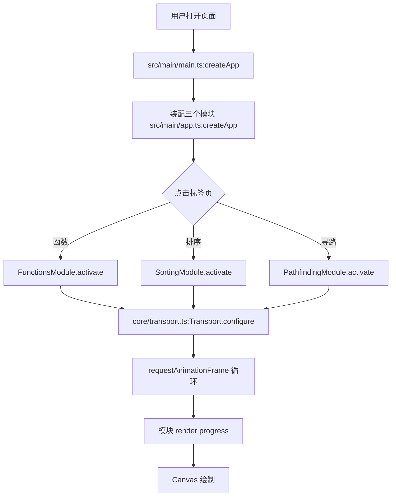

# 项目定位与成功判据

- [概述](#概述)
- [问题与动机](#问题与动机)
- [目标](#目标)
- [非目标](#非目标)
- [成功判据](#成功判据)
- [执行流程图](#执行流程图)
- [对外 API 参数](#对外-api-参数)
- [方法传参](#方法传参)
- [代码路径](#代码路径)
- [相关文档](#相关文档)

## 概述

AlgoViz 是一个**纯前端、零后端、零框架**的可视化工具：同一套播放器驱动「函数曲线」与「算法过程」两类内容。
读者是维护者与二次开发者；适用版本 `0.4.0`；前置条件是 Node ≥ 20 与 pnpm。
它解决的问题是：数学函数与算法执行过程都是**抽象且随时间/步骤变化**的，静态截图讲不清，需要一个能暂停、单步、回看的观察窗口。

## 问题与动机

| 现状 | 问题 |
|---|---|
| 函数图像工具只能看终态 | 看不到「参数变化时曲线怎么动」 |
| 排序/寻路演示多半是视频 | 不能停在自己想看的那一步 |
| 两者通常分属两个项目 | 同类交互（播放、单步、倍速）被迫重复实现三遍 |

判据：如果两个模块的播放器代码不能复用，说明抽象选错了。

## 目标

1. 一个应用内提供函数、排序、寻路三个可切换模块。
2. 三个模块共用同一个 `Transport`（归一化进度），播放/单步/倍速/拖拽只有一份实现。
3. 表达式求值不依赖 `eval`，可离线、可在严格 CSP 下运行。
4. 构建产物 < 100 KB、无运行时依赖、可直接静态托管。

## 非目标

| 不做 | 原因 |
|---|---|
| 后端与账号体系 | 没有需要持久化的状态，加了只会增加部署面 |
| 3D / WebGL | 二维信息密度对本项目已足够，WebGL 会把调试成本翻倍 |
| 图论高级算法（网络流、Tarjan） | 第一版先证明「帧模型」可扩展，算法清单后补 |
| 复杂函数（隐函数、极坐标、参数方程） | 解析口径与交互都不同，值得单独立项而不是塞进现有输入框 |

## 成功判据

| 编号 | 判据 | 证据（20261114） |
|---|---|---|
| S-1 | 三条模块都有可播放的分步状态，且单步可回退 | 三个标签页截图；`Transport.stepBy(-1)` 单测覆盖在 `600001` |
| S-2 | 播放器实现只有一份 | `src/main/core/transport.ts` 被三个模块共同引用，无复制 |
| S-3 | `pnpm build` 与 `pnpm test` 均退出码 0，产物 < 100 KB | 97 tests passed；`dist` JS 77.5 KB（gzip 27.3 KB） |
| S-4 | 表达式解析无 `eval` | `src/main/math/evaluate.ts` 全部为闭包编译，源码 grep 无 `eval(` / `new Function` |

判据可推翻条件：若后续模块间的时间语义分化（例如函数需要连续插值、算法需要离散帧），`progress` 单一数值抽象不再够用，应拆成 `Clock` + `FrameIndex` 两套，并改写 `300001`。

## 执行流程图

失败出口：表达式非法时输入框标红并在侧栏给出中文原因，曲线不绘制（不抛异常、不白屏）。

## 对外 API 参数

无，原因：本项目不提供 HTTP 接口，也不作为库被外部调用。等价证据是三条可执行命令：

| 命令 | 作用 | 失败语义 |
|---|---|---|
| `pnpm dev` | 开发服务器 | 端口占用时 Vite 自行换端口并提示 |
| `pnpm build` | 类型检查 + 生产构建 | 类型错误时退出码非 0，不产出 `dist/` |
| `pnpm test` | 97 条判定表用例 | 任一失败退出码非 0 |

## 方法传参

无对外方法。内部契约见 `300001`（`Transport` / `VizModule`）与 `300002`（`compileSource` / `validate`）。

## 代码路径

| 项 | 路径 |
|---|---|
| 入口 | `index.html` → `src/main/main.ts:createApp` |
| 装配 | `src/main/app.ts:createApp` |
| 播放器 | `src/main/core/transport.ts:Transport` |
| 产物 | `dist/index.html`、`dist/assets/*.js`、`dist/assets/*.css` |

## 相关文档

- 上级：`docs/100000-愿景与边界索引.md`
- 派生：`docs/300001-总体架构与帧时间轴.md`、`docs/600001-测试策略与判定表.md`
- 外部：`sources/GitHubRise/general-policies/general/engineering/development-method.md`
