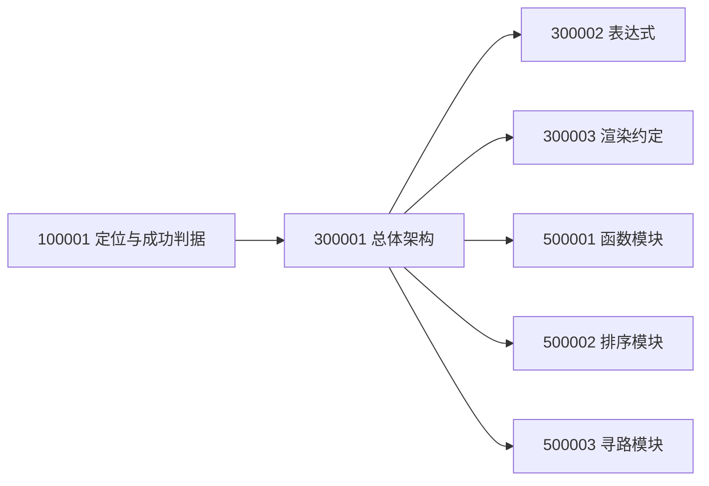

# 设计与架构 · 大类索引

- [概述](#概述)
- [子文档索引](#子文档索引)
- [依赖关系](#依赖关系)
- [入口与路径](#入口与路径)
- [数据概览](#数据概览)
- [实现状态](#实现状态)
- [涉及文件](#涉及文件)
- [相关文档](#相关文档)

## 概述

大类 `3` 回答「系统怎么分层、关键决策是什么、为什么这么定」。
不细分次大类，正文从 `300001` 起。三篇分别覆盖：整体架构与帧模型、表达式链路、渲染约定。

建议顺序：`300001` → `300002` → `300003`。

## 子文档索引

| 编号 | 标题 | 一句话 | 状态 | 更新日期 |
|---|---|---|---|---|
| 300001 | 总体架构与帧时间轴 | 模块边界、Transport、三条关键决策 | 已完成 | 20261114 |
| 300002 | 表达式解析与求值 | 词法/语法/编译、优先级与错误口径 | 已完成 | 20261114 |
| 300003 | 画布渲染与主题约定 | DPR、坐标变换、采样断点、颜色角色 | 已完成 | 20261114 |

## 依赖关系

## 入口与路径

| 项 | 路径 | 作用 | 可直接执行 |
|---|---|---|---|
| 装配 | `src/main/app.ts:createApp` | 注册模块与标签页 | 是 |
| 时间轴 | `src/main/core/transport.ts:Transport` | 播放状态机 | 是 |
| 渲染基座 | `src/main/core/surface.ts:Surface` | 画布尺寸与 DPR | 是 |

## 数据概览

| 结构 | 字段 | 类型 | 口径 |
|---|---|---|---|
| `Transport` | `progress` | `number` | 归一化 0..1，唯一时间源 |
| `VizModule` | `panel` / `stage` | `HTMLElement` | 模块自持 DOM，外壳只做挂载 |
| `PlotView` | `cx` `cy` `scale` | `number` | 世界坐标中心 + 每单位像素数 |

## 实现状态

| 分项 | 状态 | 证据 |
|---|---|---|
| 帧模型 | 已完成 | `300001`；三模块共用，`git grep Transport` 仅一处实现 |
| 表达式链路 | 已完成 | 16 条回归用例通过 |
| 渲染约定 | 已完成 | 三模块截图；DPR 上限 2 |

## 涉及文件

| 文件 | 职责 |
|---|---|
| `src/main/core/transport.ts` | 播放器状态机 |
| `src/main/core/surface.ts` | Canvas 封装 |
| `src/main/core/theme.ts` | 颜色与字体 |
| `src/main/math/*.ts` | 表达式链路 |

## 相关文档

- 上级：`docs/000000-全库总索引.md`
- 前置：`docs/100001-项目定位与成功判据.md`
- 派生：`docs/500000-交互与可视化模块索引.md`
