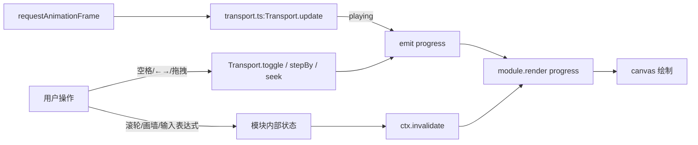

# 总体架构与帧时间轴

- [概述](#概述)
- [分层](#分层)
- [关键设计决策](#关键设计决策)
- [执行流程图](#执行流程图)
- [对外 API 参数](#对外-api-参数)
- [方法传参](#方法传参)
- [代码路径](#代码路径)
- [相关文档](#相关文档)

## 概述

本文定义 AlgoViz 的分层、模块契约，以及把「函数动画」与「算法分步」统一起来的核心抽象——**归一化进度**。
读者是要新增模块或改播放器的人；前置是读过 `100001`。
读完后你应当能：不碰播放器代码，新增第四个可视化模块。

## 分层

| 层 | 目录 | 只做什么 | 不做什么 |
|---|---|---|---|
| 外壳 | `src/main/app.ts` | 标签页、rAF 循环、键盘、ResizeObserver | 不碰任何绘制细节 |
| 时间轴 | `src/main/core/transport.ts` | 播放状态机、进度归一化 | 不知道画的是什么 |
| 基座 | `src/main/core/{surface,theme,dom}.ts` | 画布尺寸/DPR、颜色、DOM 构造 | 不含业务语义 |
| 领域计算 | `src/main/math/`、`modules/*/algorithms.ts` | 纯函数：表达式求值、帧序列 | 不引用 DOM |
| 可视化模块 | `src/main/modules/*/module.ts` | 组装控件、响应交互、绘制 | 不实现播放逻辑 |

依赖方向单向：外壳 → 时间轴 → 基座；模块只依赖基座与领域计算。

## 关键设计决策

| 决策 | 选了什么 | 否了什么 | 依据 | 可推翻条件 |
|---|---|---|---|---|
| 时间抽象 | 归一化 `progress ∈ [0,1]` | 帧索引 / 绝对时间 | 函数是连续量、算法是离散量，只有归一化能同时承载；拖拽进度条天然对应 | 出现「不同段需要不同速度」或「一帧不一定等权」时，改 `Clock` + `FrameIndex` 双轨 |
| UI 层 | 原生 DOM + Canvas，无框架 | React / Vue | 三个模块的表单量很小，产物 83 KB；框架带来的抽象成本大于收益 | 模块数 > 6，或需要复杂表单校验/状态同步时 |
| 绘图 | Canvas 2D | SVG | 曲线每帧采样数千点，SVG 节点开销与重排代价高 | 需要逐条曲线可选中、可被读屏软件识别时 |
| 求值 | 自写 Pratt 解析 + 闭包编译 | `eval` / `new Function` | 可在严格 CSP 下运行；错误信息可定位到字符位置 | 需要支持自定义函数定义与递归时，可能要引入真正的解释器 |
| 模块契约 | 模块自持 DOM 与画布 | 外壳统一渲染 | 三个模块的交互差异大（滚轮缩放 vs 拖拽画墙），统一外壳反而增加分支 | 出现大量重复的工具栏时，抽公共控件层 |

## 执行流程图



`invalidate()` 只置脏标记，真正重绘统一在 rAF 里发生——避免一次交互触发多次绘制。

## 对外 API 参数

本模块不提供 HTTP 接口。对内的「对外契约」是 `Transport` 的公开方法，改签名会影响三个模块：

| 方法 | 参数 | 返回值 | 语义 |
|---|---|---|---|
| `play()` | — | `void` | 非循环且已到末尾时先归零再播 |
| `pause()` / `toggle()` | — | `void` | — |
| `seek(p)` | `p: number` | `void` | 夹紧到 `[0,1]`，不受播放状态影响 |
| `stepBy(delta)` | `delta: number`（单位：步） | `void` | 先暂停，再按 `stepSize` 平移 |
| `update(dtMs)` | `dtMs: number`（真实毫秒） | `boolean` 进度是否变化 | 仅播放时推进；循环模式下取模 |
| `configure(opts)` | `{ durationMs?, loop?, stepSize? }` | `void` | `durationMs` 最小 120 |
| `setSpeed(v)` | `v: number` | `void` | 夹紧到 `[0.125, 8]` |
| `subscribe(fn)` | `fn: (p, playing) => void` | 退订函数 | 订阅时立即回调一次 |

错误语义：以上方法均不抛异常；非法输入按夹紧处理。

## 方法传参

```ts
/** src/main/core/transport.ts */
class Transport {
  get progress(): number;      // 0..1
  get playing(): boolean;
  get speed(): number;         // 倍速，0.125..8
  get loop(): boolean;
  get stepSize(): number;      // 单步对应的 progress 增量
}

/** src/main/ui/module.ts */
interface VizModule {
  readonly id: string;
  readonly label: string;
  readonly panel: HTMLElement;   // 侧栏容器，外壳负责显示/隐藏
  readonly stage: HTMLElement;   // 画布容器，绝对定位铺满 stage
  activate(): void;              // 切入：配置 transport、重置或恢复状态
  deactivate(): void;            // 切出：清理临时交互状态（如拖拽中）
  render(progress: number): void;// 唯一的绘制入口，必须幂等
  resize(): void;                // 容器尺寸变化后调用
}

interface ModuleContext {
  transport: Transport;
  invalidate(): void;            // 请求下一帧重绘
}
```

约束：`render` 必须是**幂等**的（同一个 progress 画两次结果一致），否则单步回退会漂移。
`activate()` 允许调用 `transport.configure()`；`deactivate()` 不得销毁 transport。

## 代码路径

| 项 | 路径 |
|---|---|
| 外壳与循环 | `src/main/app.ts:createApp` |
| 时间轴 | `src/main/core/transport.ts:Transport` |
| 模块契约 | `src/main/ui/module.ts:VizModule` |
| 画布封装 | `src/main/core/surface.ts:Surface` |
| 主题 | `src/main/core/theme.ts:theme` |

## 相关文档

- 上级：`docs/300000-设计与架构索引.md`
- 前置：`docs/100001-项目定位与成功判据.md`
- 派生：`docs/300002-表达式解析与求值.md`、`docs/300003-画布渲染与主题约定.md`、`docs/500001-函数绘图模块.md`
