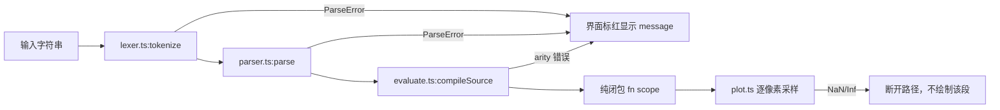

# 表达式解析与求值

- [概述](#概述)
- [语法](#语法)
- [优先级](#优先级)
- [内置函数与常量](#内置函数与常量)
- [错误口径](#错误口径)
- [执行流程图](#执行流程图)
- [对外 API 参数](#对外-api-参数)
- [方法传参](#方法传参)
- [代码路径](#代码路径)
- [相关文档](#相关文档)

## 概述

本文说明函数模块的表达式链路：字符串 → 词法 → AST → 闭包。
读者是要改语法、加函数或排查「为什么这条曲线画不出来」的人；前置是 `300001`。
设计约束：不使用 `eval` / `new Function`，错误信息必须能定位到字符位置。

## 语法

| 类别 | 形态 | 例 |
|---|---|---|
| 数字 | 十进制、小数、科学计数 | `2`、`0.5`、`1e-3` |
| 变量 | 标识符；`x` 为横坐标，`t` 为动画参数 | `x`、`t` |
| 常量 | `pi` `e` `tau` `phi` | `2pi` |
| 运算 | `+ - * / % ^`（`**` 等价 `^`） | `x^2` |
| 函数调用 | `name(a, b, …)` | `min(x, 1)` |
| 隐式乘法 | 数字/标识符/`)` 后紧跟另一项 | `2x`、`(x+1)(x-1)`、`sin(x)cos(x)` |

隐式乘法的实现位于 `parser.ts`：在 `parseExpr` 的循环里，若下一个 token 能开始一个新项（数字、标识符、左括号），就按乘号插入。因此 `x -1` 是减法而 `x(-1)` 是乘法。

## 优先级

| 级别 | 运算 | 结合性 |
|---|---|---|
| 1（低） | `+` `-` | 左 |
| 2 | `*` `/` `%`、隐式乘 | 左 |
| 3 | 一元 `+` `-` | 右（作用于整项） |
| 4（高） | `^` | 右 |

因此：`1+2*3=7`、`2^3^2=512`、`-2^2=-4`、`4-2-1=1`。

## 内置函数与常量

| 函数 | 参数 | 说明 |
|---|---|---|
| `sin cos tan asin acos atan` | 1 | 三角函数（弧度） |
| `atan2(y, x)` | 2 | 两参数反正切 |
| `sinh cosh tanh` | 1 | 双曲 |
| `sqrt cbrt abs exp ln log log2 log10` | 1 | `log` 为常用对数 |
| `floor ceil round trunc sign` | 1 | 取整与符号 |
| `min max` | 1~8 | 多参数 |
| `pow(a,b) mod(a,b)` | 2 | 幂与取余 |
| `clamp(v, lo, hi)` | 3 | 截断到区间 |
| `step(edge, x)` | 2 | 阶跃 |
| `smoothstep(e0, e1, x)` | 3 | 平滑阶跃 |
| `gauss(x) logistic(x)` | 1 | `e^(-x²)` 与逻辑斯蒂 |

常量：`pi`、`e`、`tau`、`phi`。

## 错误口径

| 输入 | 错误信息（`ParseError.message`） | 位置 |
|---|---|---|
| `""` / `"  "` | 表达式为空 | 0 |
| `1 +` | 表达式不完整 | 末尾 |
| `(1 + 2` | 缺少右括号 ")" | 末尾 |
| `sin(1, 2)` | 函数 "sin" 需要 1 个参数，实际给了 2 个 | 0（编译期） |
| `2 @ 3` | 无法识别的字符 "@" | 2 |
| `sin` | 函数 "sin" 需要参数，例如 sin(x) | 末尾 |

未知变量**不报错**：求值得到 `NaN`，由界面提示「按变量处理：foo（当前取值为 0）」。这是刻意选择——用户可能先写公式再给参数。

## 执行流程图



## 对外 API 参数

无 HTTP 接口。对内导出：

| 导出 | 签名 | 说明 |
|---|---|---|
| `compileSource` | `(src: string) => Compiled` | 失败抛 `ParseError` |
| `validate` | `(src: string) => {ok: true, variables} \| {ok: false, message}` | 不抛异常，供输入框实时校验 |
| `parse` | `(src: string) => Node` | 只要 AST 时用 |
| `tokenize` | `(src: string) => Token[]` | 调试用 |

## 方法传参

```ts
interface Compiled {
  fn: (scope: Scope) => number;   // 缺变量取 NaN，不抛异常
  variables: string[];            // 非内置变量名，按出现顺序去重
  source: string;
}
type Scope = Record<string, number>;   // 典型：{ x, t }

class ParseError extends Error {
  readonly pos: number;   // 出错字符下标（0 起）
}
```

副作用：无。`compileSource` 不修改输入，不读全局状态。

## 代码路径

| 项 | 路径 |
|---|---|
| 词法 | `src/main/math/lexer.ts:tokenize` |
| 语法 | `src/main/math/parser.ts:parse` |
| 编译 | `src/main/math/evaluate.ts:compileSource` |
| 函数表 | `src/main/math/functions.ts:FUNCTIONS` |
| 回归用例 | `src/test/parser.test.ts`（T-E01..T-E16） |

## 相关文档

- 上级：`docs/300001-总体架构与帧时间轴.md`
- 使用方：`docs/500001-函数绘图模块.md`
- 验证：`docs/600001-测试策略与判定表.md`
