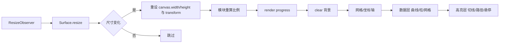

# 画布渲染与主题约定

- [概述](#概述)
- [尺寸与设备像素比](#尺寸与设备像素比)
- [坐标变换](#坐标变换)
- [曲线采样与断点](#曲线采样与断点)
- [颜色角色码](#颜色角色码)
- [执行流程图](#执行流程图)
- [对外 API 参数](#对外-api-参数)
- [方法传参](#方法传参)
- [代码路径](#代码路径)
- [相关文档](#相关文档)

## 概述

本文约定三个模块共用的画布规则：尺寸、坐标、采样、颜色。
读者是要新增绘制内容或改配色的人；前置是 `300001`。
目标：同一套约定下，三个模块的视觉重量一致，换主题只改一处。

## 尺寸与设备像素比

| 规则 | 取值 | 原因 |
|---|---|---|
| 画布逻辑尺寸 | 由容器 `getBoundingClientRect()` 决定 | 跟随布局，不写死 |
| DPR 上限 | `2` | 3x 屏上字符渲染收益极低，绘制成本 ×2.25 |
| 变换 | `ctx.setTransform(dpr, 0, 0, dpr, 0, 0)` | 之后所有坐标都是 CSS 像素 |
| 最小尺寸 | 1×1 | 面板折叠时避免零宽画布被除 |

`Surface.resize()` 返回尺寸是否真的变化，调用方据此决定要不要重算内部比例。

## 坐标变换

函数图使用「中心点 + 每单位像素数」，x/y 共用 `scale`，保证等比例：

```
sx = W/2 + (x - cx) * scale
sy = H/2 - (y - cy) * scale
```

- 缩放以光标为锚点：先记下光标处世界坐标，改 `scale` 后再算一次，把差值补进 `cx/cy`。
- `scale` 夹紧到 `[6, 8000]` px/单位。
- 网格步长取「1/2/5 × 10ⁿ」中使主格接近 78 px 的那个。
- 轴标签贴边时被夹到画布内，避免跑到视口外。

## 曲线采样与断点

| 场景 | 判断 | 处理 |
|---|---|---|
| 每列采样 | 每 0.75 px 一次 | 足够平滑且不浪费 |
| 非有限值 | `!isFinite(y)` | 断开路径，下一点重新 `moveTo` |
| 极端值 | 屏幕 y 超出 `[-4H, 5H]` | 不进入路径，防止坐标爆炸 |
| 相邻跳变 | `|Δy| > 1.6H` | 视为渐近线，断开不连线 |

`tan(x)`、`1/x` 在断点附近就是靠后两条规则避免出现竖直长线。

积分填充用 260 段折线建多边形；数值用 400 段辛普森法，与绘制用的采样相互独立。

## 颜色角色码

排序模块的 `roles: Uint8Array` 是唯一需要「按值取色」的地方，取值域固定 0..5：

| 码 | 含义 | 颜色 |
|---|---|---|
| 0 | 普通 | `#2f3d55` |
| 1 | 比较中 | `#ffd166` |
| 2 | 交换/写入 | `#ff6b6b` |
| 3 | 基准（pivot） | `#c77dff` |
| 4 | 已就位 | `#4ade80` |
| 5 | 游标 | `#4cc9f0` |

寻路与函数图不使角色码，各自用语义颜色：墙 `#33415c`、已访问 `#22374d`、前沿 `#3d7ea6`、路径 `#ffd166`、起 `#4ade80`、终 `#ff6b6b`。

字体：界面 `13px` 系统无衬线；画布数值与坐标用等宽（`JetBrains Mono` → `Cascadia Code` → `Consolas`）。

## 执行流程图



## 对外 API 参数

无 HTTP 接口。渲染层的公开面是 `Surface`：

| 方法/属性 | 参数 | 返回 | 说明 |
|---|---|---|---|
| `resize()` | — | `boolean` 是否变化 | 内部会重设 DPR 与 transform |
| `clear(fill?)` | `fill: string` | `void` | 默认 `theme.bg` |
| `hint(text)` | `text: string` | `void` | 左下角灰字提示 |
| `width` `height` `dpr` | — | `number` | 只读，CSS 像素 |

## 方法传参

```ts
interface PlotOptions {
  showGrid: boolean;
  showTangent: boolean;
  tangentX: number;      // 世界坐标 x
  showIntegral: boolean;
  integralA: number;     // 积分下限，可与 B 互换
  integralB: number;
  hover: { x: number; y: number } | null;  // CSS 像素
  t: number;             // 动画参数，0..1
}

class PlotView {
  zoomAt(sx: number, sy: number, factor: number): void;  // factor > 1 放大
  pan(dxPx: number, dyPx: number): void;
  screenToWorld(sx: number, sy: number): { x: number; y: number };
  worldToScreen(x: number, y: number): { x: number; y: number };
  reset(): void;   // 回到原点，scale = min(W,H)/11
}
```

## 代码路径

| 项 | 路径 |
|---|---|
| 画布封装 | `src/main/core/surface.ts:Surface` |
| 主题 | `src/main/core/theme.ts` |
| 函数绘制 | `src/main/modules/functions/plot.ts:PlotView` |
| 排序配色 | `src/main/modules/sorting/module.ts:ROLE_COLORS` |
| 寻路配色 | `src/main/modules/pathfinding/module.ts:drawCells` |

## 相关文档

- 上级：`docs/300001-总体架构与帧时间轴.md`
- 使用方：`docs/500001-函数绘图模块.md`、`docs/500002-排序可视化模块.md`、`docs/500003-寻路可视化模块.md`
