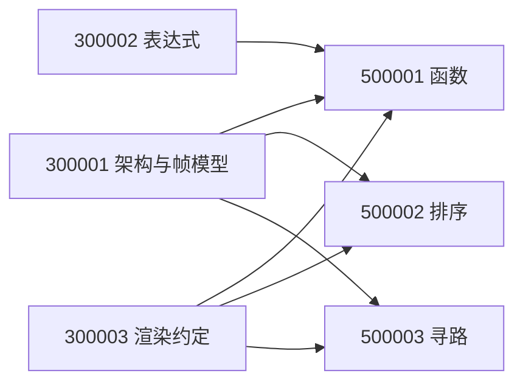

# 交互与可视化模块 · 大类索引

- [概述](#概述)
- [子文档索引](#子文档索引)
- [依赖关系](#依赖关系)
- [入口与路径](#入口与路径)
- [数据概览](#数据概览)
- [实现状态](#实现状态)
- [涉及文件](#涉及文件)
- [相关文档](#相关文档)

## 概述

大类 `5` 描述三个可视化模块各自的控件、手势与绘制顺序。
读者是要改交互或加新模块的人；前置是 `300001`（模块契约）与 `300003`（渲染约定）。

三篇结构一致：控件清单 → 手势表 → 绘制顺序 → 已知限制。

## 子文档索引

| 编号 | 标题 | 一句话 | 状态 | 更新日期 |
|---|---|---|---|---|
| 500001 | 函数绘图模块 | 表达式输入、缩放平移、切线与积分 | 已完成 | 20261114 |
| 500002 | 排序可视化模块 | 五种排序的分步帧与角色高亮 | 已完成 | 20261114 |
| 500003 | 寻路可视化模块 | 网格编辑、四种搜索、分阶段揭示 | 已完成 | 20261114 |

## 依赖关系

## 入口与路径

| 模块 | 入口 | 命令 |
|---|---|---|
| 函数 | `src/main/modules/functions/module.ts:FunctionsModule` | `pnpm dev` |
| 排序 | `src/main/modules/sorting/module.ts:SortingModule` | `pnpm dev` |
| 寻路 | `src/main/modules/pathfinding/module.ts:PathfindingModule` | `pnpm dev` |

## 数据概览

| 模块 | 关键状态 | 范围 |
|---|---|---|
| 函数 | `curves[].compiled` | 最多 2 条（`initial` 参数决定） |
| 排序 | `size` / `pattern` / `kind` | n ∈ 8..72；5 种算法 |
| 寻路 | `grid` | 39×23（奇数，供迷宫生成） |

## 实现状态

| 分项 | 状态 | 证据 |
|---|---|---|
| 函数 | 已完成 | 截图 + 16 条解析回归用例 |
| 排序 | 已完成 | 5 算法 × 14 条用例；spike 记录帧规模 |
| 寻路 | 已完成 | 4 算法 × 16 条用例 |

## 涉及文件

| 文件 | 职责 |
|---|---|
| `modules/functions/{module,plot}.ts` | 函数模块与绘图视图 |
| `modules/sorting/{module,algorithms}.ts` | 排序 UI 与帧录制 |
| `modules/pathfinding/{module,algorithms,grid}.ts` | 寻路 UI、搜索、网格操作 |
| `ui/controls.ts` | 侧栏控件与播放器 |

## 相关文档

- 上级：`docs/000000-全库总索引.md`
- 前置：`docs/300001-总体架构与帧时间轴.md`
- 派生：`docs/600001-测试策略与判定表.md`
