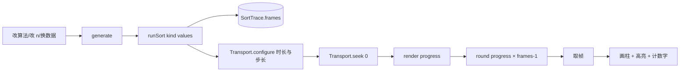

# 排序可视化模块

- [概述](#概述)
- [帧与角色码](#帧与角色码)
- [五种算法](#五种算法)
- [控件与手势](#控件与手势)
- [已知限制](#已知限制)
- [执行流程图](#执行流程图)
- [对外 API 参数](#对外-api-参数)
- [方法传参](#方法传参)
- [代码路径](#代码路径)
- [相关文档](#相关文档)

## 概述

把五种排序算法的每一步「比较 / 交换 / 写入」录成帧，播放器按进度取帧渲染，因此可以单步、回退、拖到任意位置。
读者是要加算法或改渲染的人；前置是 `300001`、`300003`。

## 帧与角色码

```ts
interface SortFrame {
  values: number[];      // 当前数组快照（不是引用）
  roles: Uint8Array;     // 每个位置的角色码 0..5
  comparisons: number;   // 到本帧为止的累计比较次数
  writes: number;        // 累计写入次数（交换记 2 次写入）
  note: string;          // 人类可读的一步说明，如「比较 a[3]=5 与 a[4]=2」
}
```

`roles` 的取值与颜色见 `300003`。录制器 `Recorder` 的关键设计：

- **快照而非引用**：每帧复制数组，避免后续修改污染已录帧。
- **排序进度用旁路标记**：`sortedFlags` 与当前角色分开存，快照时合并为「没有活动角色就显示已就位」，否则绿色会把比较高亮吃掉。
- **基准保持可见**：`pivotIndex` 在交换时跟着移动，比较到基准时仍显示紫色。

帧数实测（n=72，倒序，`pnpm spike`）：冒泡 5186、插入 5186、选择 2666、归并 758、快速 2808。

## 五种算法

| 算法 | 思路 | 特点 |
|---|---|---|
| 冒泡 | 相邻逆序就换，一趟定一个最大值 | 帧数最多，冒泡的「已就位」从右往左长 |
| 插入 | 把当前元素向左挪到正确位置 | 近有序时比较次数骤降 |
| 选择 | 每轮找最小值换到前面 | 交换次数少，比较次数固定 |
| 归并 | 递归二分 + 辅助数组归并 | 帧数远少于 O(n²) 系列，写入次数多 |
| 快速 | Lomuto 分区，基准取末尾元素 | 基准紫色高亮，递归分治 |

归并的 `compare(i, j)` 用辅助数组的值做判断，但角色仍标在原数组对应位置上——这是可视化近似，不影响计数正确性（见判定表 T-S04/T-S14）。

## 控件与手势

| 控件 | 行为 |
|---|---|
| 算法下拉 | 换算法后用同一组数据重新录制并回到第 0 帧 |
| 数据规模 n | 8..72，改 n 会重新生成数据 |
| 随机 / 近有序 / 逆序 / 少量重复 | 四种数据分布 |
| 播放器 | 空格播放暂停，←→ 单步，进度条拖拽 |
| 点击画布 | 播放/暂停 |

播放时长由帧数决定：`duration = clamp(帧数 × 42, 900, 14000)` ms；`stepSize = 1/(帧数-1)`。

## 已知限制

| 限制 | 说明 |
|---|---|
| 帧是整帧快照，不做增量 | n=72 冒泡约 3.4 MB，可接受；n>150 需要改成增量帧 |
| 归并的辅助数组不单独可视化 | 只画归并结果写回的位置 |
| 不显示递归深度 | 快速/归并在小 n 下看得清，大 n 下会丢失结构感 |

## 执行流程图



## 对外 API 参数

无 HTTP 接口。对内的核心是 `runSort`：

| 导出 | 签名 | 失败语义 |
|---|---|---|
| `runSort` | `(kind: SortKind, input: readonly number[]) => SortTrace` | 未知算法抛 `Error("未知排序算法: …")` |
| `SORT_KINDS` | `readonly SortKind[]` | 渲染顺序即此顺序 |
| `ROLE` | `{ idle:0, compare:1, swap:2, pivot:3, sorted:4, cursor:5 }` | 与渲染层共用 |

## 方法传参

```ts
interface SortTrace {
  kind: SortKind;
  label: string;          // 中文名，直接用于标题
  input: number[];        // 原始数据
  frames: SortFrame[];    // 首帧是初始状态，末帧是终态
  sorted: number[];       // 排序结果，应与末帧 values 相同
  comparisons: number;
  writes: number;
}
```

约束：`frames[0].values` 必须等于 `input`；`frames.at(-1).values` 必须等于 `sorted`。这两条是判定表 T-S02/T-S03 的断言，也是「首尾不错位」的唯一保证。

## 代码路径

| 项 | 路径 |
|---|---|
| 帧录制与算法 | `src/main/modules/sorting/algorithms.ts` |
| UI 与绘制 | `src/main/modules/sorting/module.ts:SortingModule` |
| 判定表 | `src/test/判定表.md`（T-S01..T-S14） |
| 用例 | `src/test/sorting.test.ts` |

## 相关文档

- 上级：`docs/500000-交互与可视化模块索引.md`
- 前置：`docs/300001-总体架构与帧时间轴.md`、`docs/300003-画布渲染与主题约定.md`
