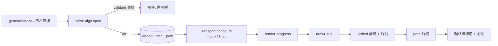

# 寻路可视化模块

- [概述](#概述)
- [网格模型](#网格模型)
- [四种搜索](#四种搜索)
- [分阶段揭示](#分阶段揭示)
- [控件与手势](#控件与手势)
- [执行流程图](#执行流程图)
- [对外 API 参数](#对外-api-参数)
- [方法传参](#方法传参)
- [代码路径](#代码路径)
- [相关文档](#相关文档)

## 概述

在 39×23 的网格上比较 BFS / DFS / Dijkstra / A* 的扩展顺序与最终路径，支持拖拽画墙、拖动起终点、一键生成迷宫。
读者是要加搜索算法或改网格交互的人；前置是 `300001`、`300003`。

## 网格模型

行优先索引：`index = y * cols + x`，`cols = 39`、`rows = 23`（奇数，递归回溯法生成迷宫要求奇数）。

```ts
interface GridSpec {
  cols: number; rows: number;
  walls: ReadonlySet<number>;   // 墙的索引集合
  start: number; goal: number;
}
```

`grid.ts` 只做纯数据操作：`createGrid`、`generateMaze`、`cellOf`、`index`，不引用 DOM。

## 四种搜索

| 算法 | 数据结构 | 保证 | 直观差异 |
|---|---|---|---|
| BFS | 队列 | 无权图上最短 | 像水波一样同心扩散 |
| DFS | 栈 | 只保证可达 | 一条路走到黑，路径常很绕 |
| Dijkstra | 二叉堆 | 代价最小 | 与 BFS 在等权网格上顺序相近 |
| A* | 二叉堆 + 曼哈顿启发 | 代价最小 | 明显朝终点方向偏，访问数通常最少 |

Dijkstra 与 A* 共用 `bestFirst(spec, heuristic)`，启发函数传 `() => 0` 即退化为 Dijkstra——避免两份几乎相同的堆实现。

## 分阶段揭示

总步数 `total = visitedOrder.length + (found ? path.length : 0)`，进度 `progress ∈ [0,1]` 映射为 `cursor = round(progress × total)`：

| `cursor` 区间 | 画什么 |
|---|---|
| `[0, visitedOrder.length)` | 只画已访问节点 + 最后 6 个作为「正在搜索」的前沿 |
| `≥ visitedOrder.length` | 在此基础上叠加路径前缀 |

这样路径只在搜索结束后才出现，符合「先找再走」的直觉；`cost = path.length - 1`，起点即终点时为 0。

## 控件与手势

| 控件 | 行为 |
|---|---|
| 算法下拉 | 换算法立即重算并回到 0 进度 |
| 画笔（画墙 / 擦除） | 按住拖动连续涂抹；拖到起终点时自动改为拖动标记 |
| 随机迷宫 | 递归回溯法重生成整张图，起终点回到默认角 |
| 清空墙 | 保留起终点与算法 |
| 重置 | 全新空网格 |
| 播放器 | 空格/←→/拖进度条 |

交互细节：`pointerdown` 决定本次拖拽是 `paint` 还是 `erase`（取决于落点是否已是墙），整段拖拽沿用同一画笔，避免来回擦写抖动。

## 执行流程图



## 对外 API 参数

无 HTTP 接口。对内：

| 导出 | 签名 | 失败语义 |
|---|---|---|
| `solve` | `(kind: AlgoKind, spec: GridSpec) => PathSolution` | 尺寸非法 / 索引越界 / 起终点在墙内 抛 `Error`（中文 message） |
| `ALGO_KINDS` | `readonly AlgoKind[]` | 顺序即下拉顺序 |
| `ALGO_LABELS` / `ALGO_NOTES` | `Record<AlgoKind, string>` | 中文名与一句话说明 |

## 方法传参

```ts
interface PathSolution {
  found: boolean;
  path: number[];        // 含起点与终点；不可达为 []
  visitedCount: number;
  cost: number;          // path.length - 1
  visitedOrder: number[];// 依确定顺序，用于逐帧播放
  parent: Int32Array;    // -1 表示无父
}
```

前置校验（`validate`）先于搜索执行：`cols/rows` 必须为正整数；`start/goal` 必须落在 `[0, cols*rows)`；二者不得在墙内。校验失败即抛错，`module.rebuild()` 捕获后显示「不可达 / 说明」。

## 代码路径

| 项 | 路径 |
|---|---|
| 搜索 | `src/main/modules/pathfinding/algorithms.ts:solve` |
| 网格与迷宫 | `src/main/modules/pathfinding/grid.ts` |
| UI 与绘制 | `src/main/modules/pathfinding/module.ts:PathfindingModule` |
| 判定表 | `src/test/判定表.md`（T-P01..T-P16） |
| 用例 | `src/test/pathfinding.test.ts` |

## 相关文档

- 上级：`docs/500000-交互与可视化模块索引.md`
- 前置：`docs/300001-总体架构与帧时间轴.md`、`docs/300003-画布渲染与主题约定.md`
