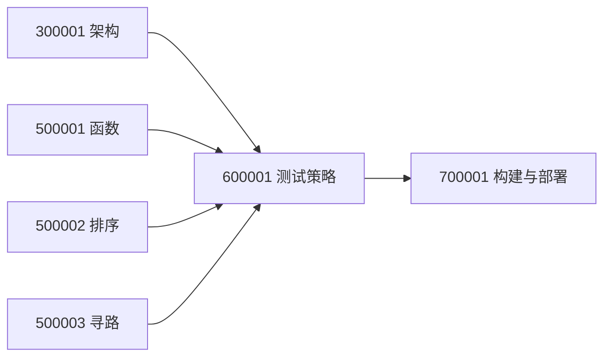

# 测试与验证 · 大类索引

- [概述](#概述)
- [子文档索引](#子文档索引)
- [依赖关系](#依赖关系)
- [入口与路径](#入口与路径)
- [数据概览](#数据概览)
- [实现状态](#实现状态)
- [涉及文件](#涉及文件)
- [相关文档](#相关文档)

## 概述

大类 `6` 回答「怎么判定对错、证据在哪」。
判定表与测试代码同目录维护（`src/test/`），本大类只写策略、口径与验收证据的位置——不复制判定表正文。

## 子文档索引

| 编号 | 标题 | 一句话 | 状态 | 更新日期 |
|---|---|---|---|---|
| 600001 | 测试策略与判定表 | TDD 口径、判定表位置、红→绿与冒烟证据 | 已完成 | 20261114 |

## 依赖关系

## 入口与路径

| 项 | 路径 | 命令 |
|---|---|---|
| 判定表 | `src/test/判定表.md` | 阅读 |
| 单元测试 | `src/test/*.test.ts` | `pnpm test` |
| 探路 | `src/demo/spike.ts` | `pnpm spike` |
| 冒烟 | 浏览器打开 `dist` 或 `pnpm preview` | `pnpm preview` |

## 数据概览

| 项 | 数值 | 条件 |
|---|---|---|
| 用例数 | 120 | 2026-11-15，vitest 2.1.9 |
| 排序用例 | 18（T-S01..T-S18） | 8 种算法 |
| 寻路用例 | 20（T-P01..T-P20） | 5 种算法 + 对角/权重 |
| 表达式用例 | 27（T-E01..T-E27） | 含比较/分段/阶乘 |
| 规范化用例 | 17（T-N01..T-N17） | 五种模式 |
| 分析与分享用例 | 15（T-A01..T-A12、T-H01..T-H03） | 含交点 |
| 复数求值用例 | 7（T-C01..T-C07） | v0.5 新增 |
| 三维投影用例 | 12（T-3D01..T-3D12） | v0.6 投影 + v0.7 等高线 |
| 算法对比用例 | 4（T-CMP01..T-CMP04） | v0.8 新增 |

## 实现状态

| 分项 | 状态 | 证据 |
|---|---|---|
| 判定表 | 已完成 | `src/test/判定表.md` |
| 单测 | 全部通过 | `pnpm test` → 120 passed |
| 红阶段 | 已执行 | 缺失模块时测试文件失败，见 `600001` 第 4 节 |
| 冒烟 | 已完成 | 浏览器截图与 console 检查，见 `memory/000009` |

## 涉及文件

| 文件 | 职责 |
|---|---|
| `src/test/判定表.md` | 输入/期望/反例 |
| `src/test/sorting.test.ts` | 排序断言 |
| `src/test/pathfinding.test.ts` | 寻路断言 |
| `src/test/parser.test.ts` | 表达式回归 |

## 相关文档

- 上级：`docs/000000-全库总索引.md`
- 前置：`docs/300001-总体架构与帧时间轴.md`
- 外部：`sources/GitHubRise/general-policies/general/engineering/development-method.md`
