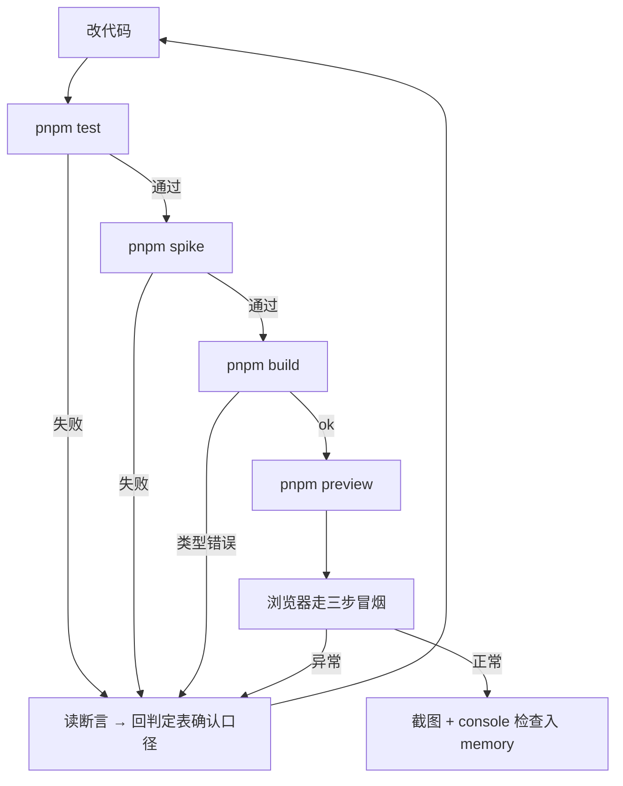

# 测试策略与判定表

- [概述](#概述)
- [判定表在哪](#判定表在哪)
- [TDD 三步的实际执行](#tdd-三步的实际执行)
- [红 → 绿证据](#红--绿证据)
- [Spike 结论](#spike-结论)
- [冒烟](#冒烟)
- [覆盖缺口](#覆盖缺口)
- [执行流程图](#执行流程图)
- [对外 API 参数](#对外-api-参数)
- [方法传参](#方法传参)
- [代码路径](#代码路径)
- [相关文档](#相关文档)

## 概述

本文记录 AlgoViz 的验证口径与实测证据：什么算对、哪些用例、红过没有、冒烟怎么跑的。
读者是要判断「这套代码能不能信」的人；结论口径跟随 `pnpm test` 与浏览器实测，不采信实现自述。
版本 `0.1.0`，证据采集于 2026-11-14（Asia/Shanghai）。

## 判定表在哪

与测试代码同目录：`src/test/判定表.md`。表内含 46 条用例，分三组：

| 组 | 编号 | 覆盖 |
|---|---|---|
| 排序 | T-S01..T-S14 | 正确性、帧不变量、角色域、未知算法反例 |
| 寻路 | T-P01..T-P16 | 最短性、路径相邻性、不可达、越界反例 |
| 表达式 | T-E01..T-E16 | 优先级、隐式乘、错误文案（回归） |

反例（标 **R**）共 7 条：未知排序算法、越界索引、起终点在墙内、网格尺寸非法、不完整表达式、缺右括号、参数个数错、非法字符。

## TDD 三步的实际执行

顺序是「判定表 → 测试（红）→ 实现（绿）」，但**表达式链路有偏差**，如实记录：

| 步骤 | 排序 / 寻路 | 表达式 |
|---|---|---|
| ① 判定表 | 先写 `判定表.md` | **后写**：parser/lexer 先于判定表完成 |
| ② 测试（红） | 先跑出 3 个测试文件失败 | 同批补写，未经历红 |
| ③ 实现（绿） | 按表实现后 46/46 通过 | 已在，测试只作回归 |

偏差原因：表达式链路是整条流水线的技术前提，先探路再补判定表更省返工；代价是这 16 条用例不能证明「测试先于实现」。
该偏差已登记在 `memory/000001`，下一版新增语法时必须先补判定表。

## 红 → 绿证据

红阶段（实现前）关键输出：

```text
Test Files  3 failed (3)
     Tests  1 failed | 15 passed (16)
FAIL  src/test/parser.test.ts > T-E13 参数个数不对报错
"__vite_ssr_import_0__.ParseError is not a constructor"
```

这条红是**真缺陷**：`parser.ts` 从 `lexer.ts` 引入 `ParseError` 但没有再导出，`evaluate.ts` 从 `parser.ts` 导入拿到 `undefined`。修法是一行再导出：

```ts
export { ParseError } from './lexer';
```

绿阶段：

```text
Test Files  3 passed (3)
     Tests  46 passed (46)
   Duration  1.42s
```

## Spike 结论

`pnpm spike`（`src/demo/spike.ts`，tsx 运行）验证三个风险点，实测于 n=72 倒序数组：

| 项 | 结论 |
|---|---|
| 解析器优先级 | 9/9 用例通过（含 `2^3^2=512`、`-2^2=-4`、`2x`、`sin(x)cos(x)`） |
| 帧规模 | 冒泡/插入 5186 帧 ≈ 3.40 MB、23 ms；选择 2666；归并 758；快速 2808 |
| 共用抽象 | 角色码域 0..5 通过，帧长一致通过 |

判定线：估算内存 ≤ 8 MB 即视为可承受。结论：**可行，不需要换技术路线**；若把 n 上限提到 150，冒泡会到约 15 MB，届时必须改增量帧。

## 冒烟

从用户入口（浏览器）走完整链路，不信中间层自述：

| 步骤 | 操作 | 观察 |
|---|---|---|
| 1 | `pnpm build` | exit 0，`dist/` 产出 index.html + js + css + `robots.txt` + `llms.txt` |
| 2 | `pnpm preview --port 4173` | HTTP 200 |
| 3 | 打开页面 | 函数页首屏渲染：两条曲线、网格、坐标轴、积分阴影 |
| 4 | 点「排序」并播放 | 进度 0%→9%，帧 1/295→27/295，比较/写入计数增长，柱体高亮 |
| 5 | 点「寻路」→ 随机迷宫 → 播放 | 迷宫生成、搜索前沿扩散、图例与起终点正常 |
| 6 | 控制台 | 无 error、无 warning |
| 7 | Lighthouse（snapshot，2026-11-14） | Accessibility **100**、Best Practices **100**、SEO **100**；Agentic Browsing 33（`llms.txt` 与 `ai-catalog.json` 两条未过，非本项目目标） |

已知问题与处理：

| 问题 | 现象 | 处理 |
|---|---|---|
| favicon 404 | 首屏 1 条 404 | 改为内联 SVG data URI 后消失 |
| `aria-selected` 用在 `button` 上 | axe 报 `aria-allowed-attr` | 补 `role="tablist"/"tab"/"tabpanel"` 与 `aria-controls` |
| 次要文字对比度 | `#5b6879`/`#111621` = 3.18:1 | 提到 `#7f8b9d`（约 5.3:1），全站通过 |
| 缺 `robots.txt` | SEO 80 → 解析 HTML 当 robots | 加 `public/robots.txt`，SEO 100 |

Chrome Issues 面板仍留 1 条「No label associated with a form field (count: 2)」提示；同一次检查里 axe（Lighthouse）判 0 违规、a11y 树显示每个控件都有名字，故按启发式误报记录，不做进一步改动。

## 覆盖缺口

| 缺口 | 风险 | 计划 |
|---|---|---|
| 无 DOM/交互自动化测试 | 拖拽、滚轮、拖进度条只经人工验证 | 需要回归时引入 jsdom 或 Playwright |
| 无性能基准 | 只测过 n=72 的帧数与耗时 | 规模上限变化前先跑 `pnpm spike` |
| 归并的辅助数组高亮是近似 | 不影响结果与计数，影响读图 | 单独立项做「辅助数组视图」 |

## 执行流程图



## 对外 API 参数

无 HTTP 接口。对外的验收面是三条命令及其退出码：

| 命令 | 期望退出码 | 失败含义 |
|---|---|---|
| `pnpm test` | 0 | 判定表不满足 |
| `pnpm spike` | 0 | 解析器或帧规模超出阈值 |
| `pnpm build` | 0 | 类型错误或打包失败 |

## 方法传参

测试只调用纯函数，不挂 DOM：

```ts
// 表达式
compileSource('2x').fn({ x: 3 });          // 6
// 排序
runSort('quick', [3, 1, 2]).sorted;        // [1, 2, 3]
// 寻路
solve('bfs', { cols: 5, rows: 5, walls: new Set(), start: 0, goal: 24 });
```

断言口径：排序钉「首帧=输入、末帧=终态、帧长一致、角色码 0..5」；寻路钉「路径相邻、不含墙、长度最短」；表达式钉「值 + 错误文案」。

## 代码路径

| 项 | 路径 |
|---|---|
| 判定表 | `src/test/判定表.md` |
| 排序用例 | `src/test/sorting.test.ts` |
| 寻路用例 | `src/test/pathfinding.test.ts` |
| 表达式用例 | `src/test/parser.test.ts` |
| 探路 | `src/demo/spike.ts` |
| 配置 | `vitest`（无独立配置文件，走 Vite 默认解析） |

## 相关文档

- 上级：`docs/600000-测试与验证索引.md`
- 前置：`docs/300001-总体架构与帧时间轴.md`
- 外部：`sources/GitHubRise/general-policies/general/engineering/development-method.md`
