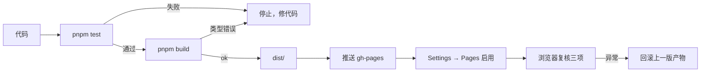

# 构建与部署

- [概述](#概述)
- [依赖与镜像](#依赖与镜像)
- [脚本](#脚本)
- [构建产物](#构建产物)
- [部署到 GitHub Pages](#部署到-github-pages)
- [回滚](#回滚)
- [执行流程图](#执行流程图)
- [对外 API 参数](#对外-api-参数)
- [方法传参](#方法传参)
- [代码路径](#代码路径)
- [相关文档](#相关文档)

## 概述

本项目是纯静态站点：构建产出 `dist/`，任何能提供静态文件的环境都可用。
读者是部署与维护的人；前置是 `600001`（测试与冒烟已通过）。
读完能独立完成一次构建、部署与回滚。

## 依赖与镜像

| 依赖 | 版本 | 用途 |
|---|---|---|
| vite | ^6.0.7（实装 6.4.6） | 开发服务器与打包 |
| typescript | ~5.6.3 | 类型检查（`tsc --noEmit`） |
| vitest | ^2.1.8（实装 2.1.9） | 单元测试 |
| tsx | ^4.23.15 | 运行 spike 脚本 |

本机 Nexus（`127.0.0.1:8081`）**不是常驻服务**，未启动时安装会卡住。用淘宝镜像，只作用于单次命令：

```bash
pnpm install --registry=https://registry.npmmirror.com
```

`pnpm-workspace.yaml` 里有两项设置，都有踩坑背景（详见 `memory/000002`）：

| 设置 | 值 | 为什么 |
|---|---|---|
| `onlyBuiltDependencies` | `[esbuild]` | pnpm 10 默认拦截依赖的安装脚本，esbuild 需要它落平台二进制 |
| `verifyDepsBeforeRun` | `false` | 每次执行脚本前的依赖校验会因 `ERR_PNPM_IGNORED_BUILDS` 判 exit 1，导致 `pnpm test` 明明全绿却失败 |

`package.json` 里旧位置的 `"pnpm"` 字段在 pnpm 10 已被忽略，设置必须放 `pnpm-workspace.yaml`。

## 脚本

| 命令 | 作用 | 退出码语义 |
|---|---|---|
| `pnpm dev` | 开发服务器（HMR） | 端口占用自动换端口 |
| `pnpm build` | `tsc --noEmit && vite build` | 类型或打包失败非 0 |
| `pnpm preview` | 预览 `dist/` | 端口占用非 0（`--strictPort` 时） |
| `pnpm test` | `vitest run` | 任一用例失败非 0 |
| `pnpm spike` | 探路脚本 | 阈值不满足非 0 |

## 构建产物

```
dist/
├── index.html          0.86 kB（含内联 SVG 图标）
├── robots.txt          静态文件（public/ 直出）
├── llms.txt            站点说明（llmstxt.org 约定）
└── assets/
    ├── index-*.css     7.72 kB（gzip 2.23 kB）
    └── index-*.js     82.86 kB（gzip 29.05 kB）
```

`vite.config.ts` 设 `base: './'`，因此产物可直接放在任意子路径下（GitHub Pages 的 `/<repo>/` 亦可），不需要改配置。
运行时零依赖：`package.json` 没有 `dependencies`，产物里没有第三方代码。

## 部署到 GitHub Pages

前置：仓库已推到 `GithubRise/algoviz`，且默认分支为 `main`。

1. 本地验证：`pnpm test && pnpm build`，两条命令都 exit 0。
2. 构建产物推到 `gh-pages` 分支（任选其一）：
   - 手动：`git subtree push --prefix dist origin gh-pages`
   - 或建工作树：`git worktree add ../algoviz-pages gh-pages`，把 `dist/` 内容拷进去后提交推送。
3. 仓库 Settings → Pages → Source 选 `gh-pages` 分支根目录，保存。
4. 打开 `https://<owner>.github.io/algoviz/` 复核：

| 检查项 | 期望 |
|---|---|
| 页面加载 | 无 404（`base: './'` 下资源用相对路径） |
| 三个标签页 | 都能切换且画布不空白 |
| 控制台 | 无 error |

自动化的最小方案（后续可加）：GitHub Actions 在 `push: main` 时跑 `pnpm install --frozen-lockfile && pnpm test && pnpm build`，再用 `actions/deploy-pages` 发布 `dist`。

## 回滚

| 场景 | 做法 |
|---|---|
| 产物有问题 | 重新构建上一个已知良好提交并覆盖 `gh-pages` |
| 依赖升级出问题 | `git revert` 提交后重装；`pnpm-lock.yaml` 随提交回滚 |
| Pages 配置改坏 | Settings 里改回原分支/目录，无需重新构建 |

不要用 `git reset --hard` 处理线上回滚——按 `general-policies/general/foundations/git-workflow.md` 第 7 节，回滚走 `revert` 或新提交。

## 执行流程图



## 对外 API 参数

无 HTTP 接口；本项目的对外交付面是静态产物 URL 与三条命令。部署侧需要的环境变量：无。

## 方法传参

无对外方法。构建相关的唯一外部输入是 `vite.config.ts` 的 `base`：

| 字段 | 取值 | 影响 |
|---|---|---|
| `base` | `'./'` | 资源以相对路径引用，可挂子路径 |
| `build.target` | `'es2022'` | 不降级语法，产物更小 |
| `build.outDir` | `'dist'` | 产物目录 |

## 代码路径

| 项 | 路径 |
|---|---|
| 依赖与脚本 | `package.json` |
| pnpm 设置 | `pnpm-workspace.yaml` |
| 构建配置 | `vite.config.ts` |
| 产物 | `dist/`（已 gitignore） |

## 相关文档

- 上级：`docs/700000-配置与部署索引.md`
- 前置：`docs/600001-测试策略与判定表.md`
- 外部：`sources/GitHubRise/general-policies/general/foundations/git-workflow.md`
